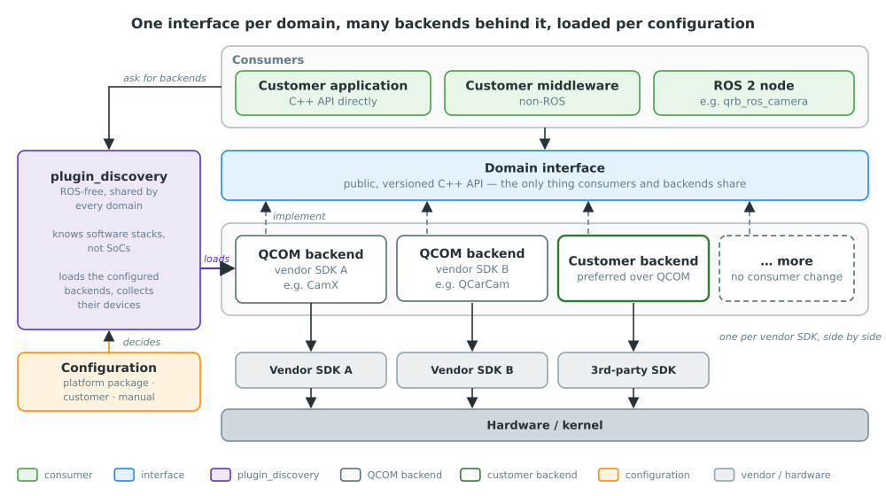
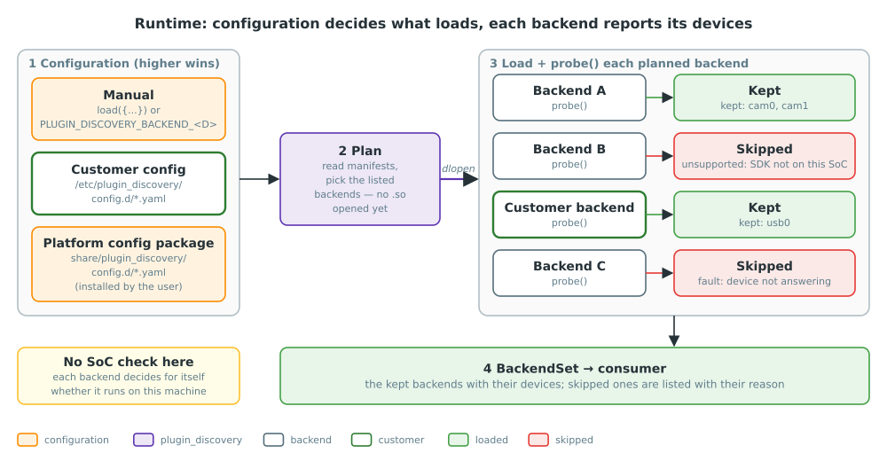
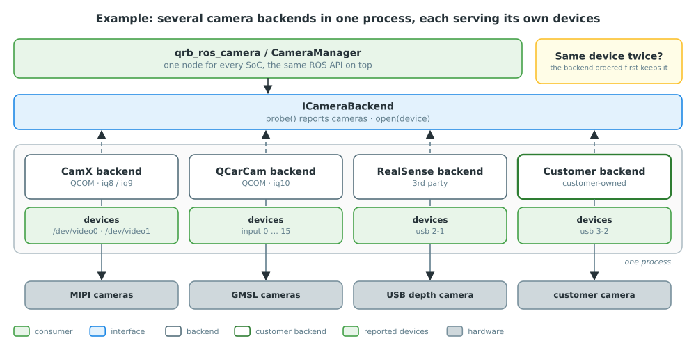
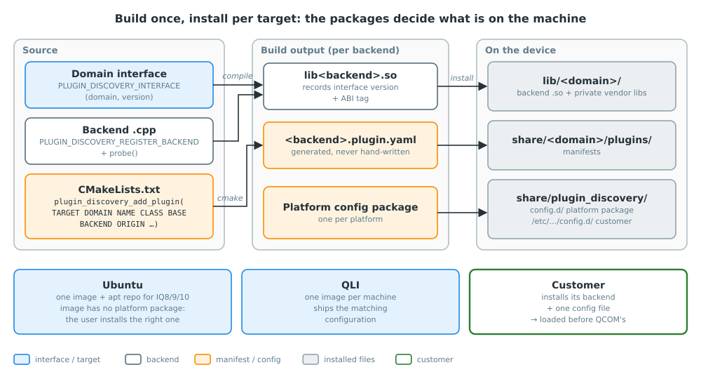

<div align="center">
  <h1>plugin_discovery</h1>
  <p align="center">
    
  </p>
  <p>Cross-platform backend mechanism for the Robotics SDK: configuration decides which backends load, and several backends of one interface run side by side in one process.</p>

  <a href="https://ubuntu.com/download/qualcomm-iot" target="_blank"></a>

</div>

**English** | [中文](README.zh-CN.md)

---

## 👋 Overview

`plugin_discovery` lets one application binary use different hardware stacks without being rebuilt. Behind each domain interface (camera / video / audio / imu / lidar …) there are several backends, and each backend wraps one vendor SDK. At runtime:

- **Configuration** decides which backends to load (a platform configuration, a customer configuration, or a manual choice).
- Each backend asks its own vendor SDK whether it works on this machine and which devices it can serve.
- Several backends of the same interface can run side by side in one process.

The library itself **knows nothing about SoCs and does not depend on ROS**. Applications, customer middleware and ROS nodes depend only on the domain interface.

**How the pieces fit together**



| Layer | Component | Responsibility |
|---|---|---|
| Loading | `libplugin_loader.so` | dlopen, registration macro, factory table, reference counting; behaves like ROS `class_loader` |
| Management | `libplugin_discovery.so` | reads manifests and configuration, decides which backends to load, checks interface version and ABI, calls `probe()`, collects devices |
| Plugins | one `.so` per backend | implements the domain interface and wraps its vendor SDK |

- A **manifest** (`*.plugin.yaml`) says which backends exist; a **configuration** file (`*.config.yaml`) says which of them load.
- Each loaded backend's `probe()` reports `Ok` (with its devices), `Unsupported` (does not run here) or `Fault` (should work but failed).
- Several backends of one interface serve their own devices in one process (camera, for instance):



- Backends are built once and installed per target; what is installed decides what is available:



> The design is described in [`docs/CROSS_PLATFORM_DESIGN.md`](docs/CROSS_PLATFORM_DESIGN.md). It has **not been verified on real hardware** yet, only with fake vendor SDKs. Some behaviour is a provisional default that may change (marked "provisional" in the docs).

## 🔎 Table of Contents

  * [APIs](#-apis)
  * [Supported Targets](#-supported-targets)
  * [Installation](#-installation)
  * [Usage](#-usage)
  * [Build from Source](#-build-from-source)
  * [Contributing](#-contributing)
  * [FAQs](#-faqs)
  * [License](#-license)

## ⚓ APIs

### 🔹 plugin_discovery C++ library APIs

Header: `plugin_discovery/plugin_registry.hpp`, `plugin_discovery/backend.hpp`. Full reference: [`docs/LIBRARY.md`](docs/LIBRARY.md).

| API | Description |
|---|---|
| `PLUGIN_DISCOVERY_INTERFACE(Base, "domain", major, minor)` | Declares a domain interface, its domain name and its version |
| `PLUGIN_DISCOVERY_REGISTER_BACKEND(Derived, Base)` | Registers a backend class in its `.so` |
| `class Backend` / `virtual ProbeResult probe()` | Base class of every backend; `probe()` returns `ProbeResult::ok(devices)`, `unsupported(why)` or `fault(why)` |
| `PluginRegistry(search_paths, config_paths)` | Registry; empty arguments fall back to the environment variables below |
| `size_t scan()` | Reads manifests and configuration; loads no library |
| `BackendSet<Base> load<Base>(manual, required_caps)` | Loads the configured backends of a domain, probes each, returns the working ones with their devices and a list of skipped ones with reasons |
| `PluginHandle<Base> create<Base>(name)` | Creates one backend by name |
| `all()` / `list(base)` / `find(name)` | Inspect the discovered manifests |
| `config_files()` / `config_view()` | Inspect the configuration files and the merged result per domain |

CMake (package `plugin_discovery`):

| Function | Description |
|---|---|
| `plugin_discovery_add_plugin(TARGET … DOMAIN … NAME … CLASS … BASE … BACKEND … [ORIGIN qcom])` | Builds a backend library and generates and installs its manifest |
| `plugin_discovery_install_config(…)` | Installs a configuration file |

Environment variables:

| Variable | Description |
|---|---|
| `PLUGIN_DISCOVERY_PATH` | Directories searched for manifests |
| `PLUGIN_DISCOVERY_CONFIG_PATH` | Directories read for configuration (replaces the default ones; for tests and trials) |
| `PLUGIN_DISCOVERY_BACKEND_<DOMAIN>` | `a,b`: manual backend choice for one domain, replaces every configuration file |

Tools:

- `pluginlib-detect [-d <domain>]` shows the merged configuration and which file every entry came from (read-only: loads no library, runs no probe).
- `platform-detect` chooses the platform configuration of this machine: it reads the machine and the OS type and links the matching candidate into the platform tier. A systemd oneshot runs it once, on the first boot.

## 🎯 Supported Targets

- Designed for Qualcomm IQ8 / IQ9 / IQ10 series devices running Ubuntu or Qualcomm Linux. The library has no SoC-specific code; SoC differences live in the backends.
- Not yet verified on hardware. The unit tests run on any Linux host with a C++17 compiler.

## ✨ Installation

There is no Debian package yet. Build and install from source (next section).

For Qualcomm Linux, see the Qualcomm Linux documentation for how to build and add packages to an image.

## 🚀 Usage

**Write a backend**

```cpp
// Domain interface (header)
class Greeter : public plugin_discovery::Backend { public: virtual std::string greet() = 0; };
PLUGIN_DISCOVERY_INTERFACE(hello::Greeter, "hello", 1, 0)

// Backend (.cpp)
plugin_discovery::ProbeResult IQ8Greeter::probe() {
  return vendor_sdk_runs_here() ? ProbeResult::ok({{"0", "", "IQ8 greeter"}})
                                : ProbeResult::unsupported("SDK does not run on this SoC");
}
PLUGIN_DISCOVERY_REGISTER_BACKEND(hello::IQ8Greeter, hello::Greeter)
```

```cmake
plugin_discovery_add_plugin(TARGET hello_backend_iq8 DOMAIN hello NAME hello/IQ8Greeter
  CLASS hello::IQ8Greeter BASE hello::Greeter BACKEND iq8 ORIGIN qcom)
```

**Use backends in an application**

```cpp
plugin_discovery::PluginRegistry registry;
registry.scan();
for (auto & b : registry.load<hello::Greeter>().backends) { b.handle->greet(); }
```

At start-up the library logs which backends loaded, which were skipped and why, so a wrong name shows up immediately.

**Write a configuration**

Configuration says which backends load. It is a small YAML file named `*.config.yaml`. The customer's is `NN-<domain>-<source>.config.yaml` (`NN`: two digits, `50` by default; `<source>`: the customer or purpose). `backends` entries are the `backend` names in the manifests (`*.plugin.yaml`), not library names.

```yaml
# /etc/plugin_discovery/config.d/50-camera-acme.config.yaml   (customer configuration)
domains:
  camera:                        # domain name, as declared by PLUGIN_DISCOVERY_INTERFACE
    backends: [qcarcam, camx]    # backends to put at the front, in this order
    disable: [v4l2]              # optional: remove these now
    # reset: true                # optional: forget what earlier files set for this domain
    # compat: true               # optional: compatibility mode (default false)
```

| You are | Put the file in | Effect |
|---|---|---|
| Platform owner | candidates `<machine>-<platform>-<domain>.config.yaml` (e.g. `QCS8275-Ubuntu-camera.config.yaml`) in `<prefix>/share/plugin_discovery/platforms.d/`, shipped by the platform package; on the first boot `platform-detect` links the matching ones as `/etc/plugin_discovery/platform.d/<domain>.config.yaml` | the backends this platform fully supports load out of the box (the library reads only `platform.d/`, never the candidates) |
| Customer | `/etc/plugin_discovery/config.d/` | applied after the platform tier, so it wins; `disable` removes platform ones, a later file can enable a disabled one again |
| Developer / test | `PLUGIN_DISCOVERY_BACKEND_<DOMAIN>=a,b` or `registry.load<T>({"a","b"})` | replaces all layers for this run |

All files are merged at run time into one final list per domain, the last file winning: the platform tier, then the customer tier (ascending `NN`); every file takes part, a customer overrides only through `reset` and `disable`; a file's backends go to the front of the list, and the first entry is the default backend. With no backend named by the caller the default is used and a failure to open it is an error; the `compat` key is parsed but its try-in-order selection is switched off for now.

- Ready-to-copy files: [`templates/`](templates). Rules: [`docs/TEMPLATES.md`](docs/TEMPLATES.md) and [`docs/LIBRARY.md`](docs/LIBRARY.md). Why the configuration works this way: [`docs/CONFIG_AND_PROBE.md`](docs/CONFIG_AND_PROBE.md).
- Try a file without installing it: `PLUGIN_DISCOVERY_CONFIG_PATH=<dir> ./your_app`.
- See the merged result: `pluginlib-detect`.

## 👨‍💻 Build from Source

Requires a C++17 compiler, CMake ≥ 3.16 and yaml-cpp (on Ubuntu: `sudo apt install build-essential cmake libyaml-cpp-dev`).

```bash
git clone https://github.com/Whisper-chen/plugin_discovery.git && cd plugin_discovery

# 1. Library + tests
cmake -S . -B build -DCMAKE_INSTALL_PREFIX=$PWD/install -DPLUGIN_LOADER_BUILD_TESTS=ON
cmake --build build -j && cmake --install build
test/run_diff.sh build                          # loading layer: same behaviour as class_loader
build/test/registry_test build/test/backends    # management layer: configuration, probe, version / ABI
test/platform_detect_test.sh build              # platform-detect: machine, OS type, candidates, first boot only
```

Layout:

```
include/  src/  cmake/          the library: plugin_loader (loading layer) + plugin_discovery (management layer)
tools/                          pluginlib-detect, platform-detect
systemd/                        first-boot unit that runs platform-detect
test/                           loading-layer differential scenarios + registry_test
templates/                      copy-and-fill templates: platform configuration (candidate), customer configuration
docs/                           design, library reference, configuration rationale, templates
```

## 🤝 Contributing

We love community contributions! Get started by reading our [CONTRIBUTING.md](CONTRIBUTING.md).  
Feel free to create an issue for bug reports, feature requests, or any discussion 💡.

## ❔ FAQs

<details>
<summary>Does the library need to know which SoC it runs on?</summary><br>
No. Which backends load is decided by configuration, and each backend asks its own vendor SDK whether it works. SoC differences stay inside the backends.
</details>

<details>
<summary>What happens if the first (default) backend cannot be used?</summary><br>
With no backend named by the caller, only the first entry of the merged list is used. If it is not loaded or cannot open the device, the call fails with that backend's error; there is no silent fallback. Name a backend explicitly or change the configuration to use another one.
</details>

<details>
<summary>What if a domain has no configuration at all?</summary><br>
All compatible backends of that domain load, with a warning. Backends that are installed but not listed in an existing configuration are not loaded and are reported as <code>not_listed</code>.
</details>

## 📜 License

Copyright (c) Qualcomm Technologies, Inc. and/or its subsidiaries. Licensed under the BSD-3-Clause-Clear License (SPDX: `BSD-3-Clause-Clear`). See [`LICENSE`](LICENSE) for the full text.
