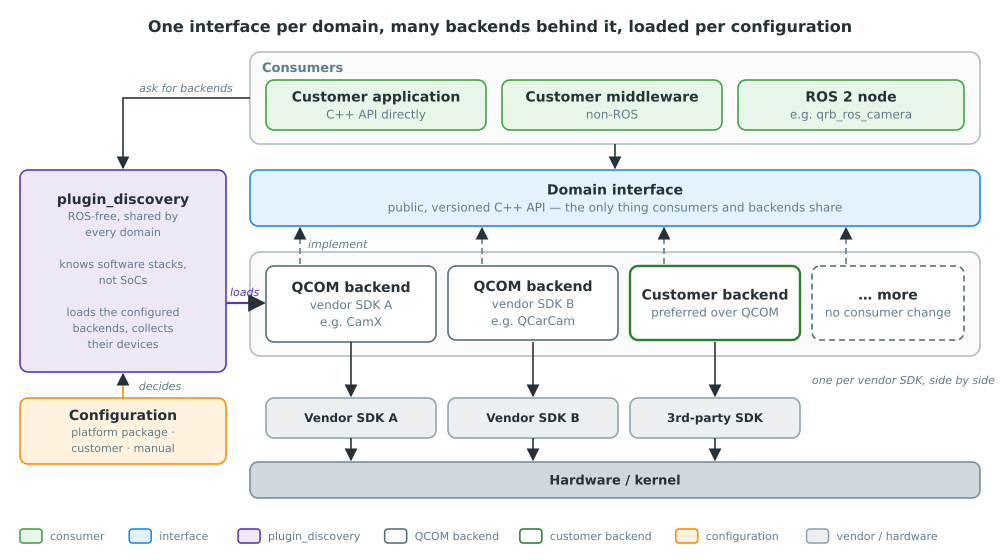
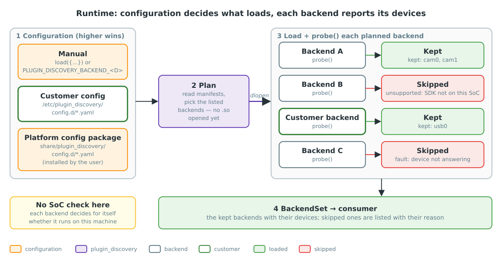
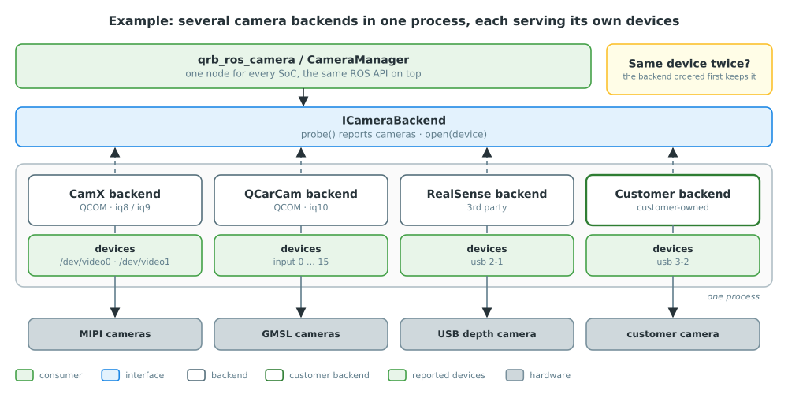
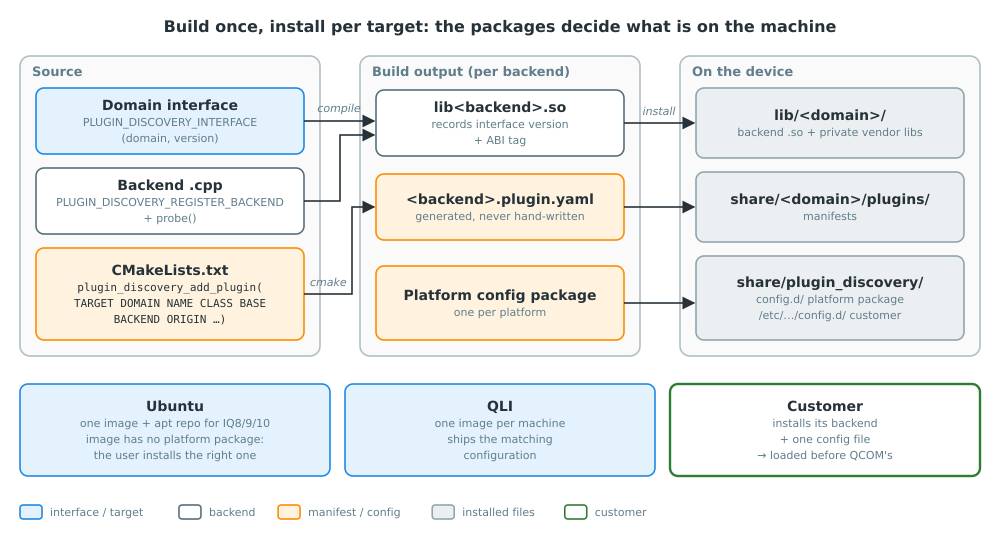

<div align="center">
  <h1>plugin_discovery</h1>
  <p align="center">
    
  </p>
  <p>Robotics SDK 的跨平台 backend 机制：由配置决定加载哪些 backend,同一个接口的多个 backend 在同一进程里同时工作。</p>

  <a href="https://ubuntu.com/download/qualcomm-iot" target="_blank"></a>

</div>

[English](README.md) | **中文**

---

## 👋 概述

`plugin_discovery` 让同一个应用程序不用重新编译，就能使用不同的硬件软件栈。一个域接口(camera / video / audio / imu / lidar …)背后有多个 backend,每个 backend 封装一套 vendor SDK。运行时：

- 由**配置**决定加载哪些 backend(platform 配置、客户配置或人工指定);
- 每个 backend 通过自己的 vendor SDK 回答"这台机器能不能用、能服务哪些设备";
- 同一个接口的多个 backend 可以在同一进程里同时工作。

库本身**不认 SoC,不依赖 ROS**。App、客户 middleware 和 ROS 节点都只依赖域接口。

**各部分如何配合**



| 层 | 组件 | 职责 |
|---|---|---|
| 加载层 | `libplugin_loader.so` | dlopen、注册宏、工厂表、引用计数;行为与 ROS `class_loader` 对齐 |
| 管理层 | `libplugin_discovery.so` | 读清单和配置、决定加载哪些 backend、校验接口版本与 ABI、调用 `probe()`、汇总设备 |
| 插件 | 各 backend 的 `.so` | 实现域接口，封装各自的 vendor SDK |

- **清单**(`*.plugin.yaml`)说明有哪些 backend;**配置**文件(`*.config.yaml`)说明加载其中哪些。
- 每个被加载的 backend 通过 `probe()` 报告 `Ok`(并给出设备)、`Unsupported`(这里跑不了)或 `Fault`(应该能用但出了故障)。
- 同一个接口的多个 backend 在同一进程里各自服务自己的设备(以 camera 为例):



- backend 只构建一次，按目标分别安装;装了什么，就有什么可用：



> 设计见 [`docs/CROSS_PLATFORM_DESIGN.zh-CN.md`](docs/CROSS_PLATFORM_DESIGN.zh-CN.md)。**尚未在真机上验证**，目前只用假 vendor SDK 测过。一些行为是可以推翻的暂定默认值(文档里标为"暂定")。

## 🔎 目录

  * [API](#-api)
  * [支持的目标](#-支持的目标)
  * [安装](#-安装)
  * [使用](#-使用)
  * [从源码构建](#-从源码构建)
  * [参与贡献](#-参与贡献)
  * [常见问题](#-常见问题)
  * [许可证](#-许可证)

## ⚓ API

### 🔹 plugin_discovery C++ 库 API

头文件：`plugin_discovery/plugin_registry.hpp`、`plugin_discovery/backend.hpp`。完整参考：[`docs/LIBRARY.zh-CN.md`](docs/LIBRARY.zh-CN.md)。

| API | 说明 |
|---|---|
| `PLUGIN_DISCOVERY_INTERFACE(Base, "domain", major, minor)` | 声明一个域接口、它的域名和版本 |
| `PLUGIN_DISCOVERY_REGISTER_BACKEND(Derived, Base)` | 在 backend 的 `.so` 里注册 backend 类 |
| `class Backend` / `virtual ProbeResult probe()` | 所有 backend 的基类;`probe()` 返回 `ProbeResult::ok(devices)`、`unsupported(why)` 或 `fault(why)` |
| `PluginRegistry(search_paths, config_paths)` | 注册表;参数为空时使用下面的环境变量 |
| `size_t scan()` | 读清单和配置;不加载任何库 |
| `BackendSet<Base> load<Base>(manual, required_caps)` | 加载一个域里配置的 backend,逐个 probe,返回能用的 backend 及其设备，以及被跳过的 backend 和原因 |
| `PluginHandle<Base> create<Base>(name)` | 按名字创建一个 backend |
| `all()` / `list(base)` / `find(name)` | 查看已发现的清单 |
| `config_files()` / `config_view()` | 查看配置文件，以及每个域合并后的结果 |

CMake(包 `plugin_discovery`):

| 函数 | 说明 |
|---|---|
| `plugin_discovery_add_plugin(TARGET … DOMAIN … NAME … CLASS … BASE … BACKEND … [ORIGIN qcom])` | 构建 backend 库，并生成、安装它的清单 |
| `plugin_discovery_install_config(…)` | 安装一个配置文件 |

环境变量：

| 变量 | 说明 |
|---|---|
| `PLUGIN_DISCOVERY_PATH` | 搜索清单的目录 |
| `PLUGIN_DISCOVERY_CONFIG_PATH` | 读取配置的目录(替换默认目录;用于测试和试用) |
| `PLUGIN_DISCOVERY_BACKEND_<DOMAIN>` | `a,b`:人工指定某个域的 backend,替换所有配置文件 |

工具：

- `pluginlib-detect [-d <domain>]` 显示合并后的配置，以及每一项出自哪个文件(只读：不加载库，不执行 probe)。
- `platform-detect` 选出本机的 platform 配置:读取 machine 和 OS 类型，把匹配的候选文件链接进平台层。由 systemd oneshot 在第一次开机时运行一次。

## 🎯 支持的目标

- 面向运行 Ubuntu 或 Qualcomm Linux 的 Qualcomm IQ8 / IQ9 / IQ10 系列设备设计。库里没有任何 SoC 相关的代码，SoC 差异由 backend 处理。
- 尚未在硬件上验证。单元测试可以在任何带 C++17 编译器的 Linux 主机上运行。

## ✨ 安装

目前还没有 Debian 包，请从源码构建和安装(见下一节)。

Qualcomm Linux 请参考 Qualcomm Linux 文档，了解如何构建并把包加入镜像。

## 🚀 使用

**写一个 backend**

```cpp
// 域接口(头文件)
class Greeter : public plugin_discovery::Backend { public: virtual std::string greet() = 0; };
PLUGIN_DISCOVERY_INTERFACE(hello::Greeter, "hello", 1, 0)

// backend(.cpp)
plugin_discovery::ProbeResult IQ8Greeter::probe() {
  return vendor_sdk_runs_here() ? ProbeResult::ok({{"0", "", "IQ8 greeter"}})
                                : ProbeResult::unsupported("SDK does not run on this SoC");
}
PLUGIN_DISCOVERY_REGISTER_BACKEND(hello::IQ8Greeter, hello::Greeter)
```

```cmake
plugin_discovery_add_plugin(TARGET hello_backend_iq8 DOMAIN hello NAME hello/IQ8Greeter
  CLASS hello::IQ8Greeter BASE hello::Greeter BACKEND iq8 ORIGIN qcom)
```

**在应用里使用 backend**

```cpp
plugin_discovery::PluginRegistry registry;
registry.scan();
for (auto & b : registry.load<hello::Greeter>().backends) { b.handle->greet(); }
```

启动时库会打印加载了哪些 backend、跳过了哪些及原因,所以名字写错会马上看到。

**编写配置**

配置决定加载哪些 backend,是一个很小的 YAML 文件,命名为 `*.config.yaml`。客户的文件命名为 `NN-<域>-<来源>.config.yaml`(`NN`:两位数字,默认 `50`;`<来源>`:客户或用途)。`backends` 里的名字是清单(`*.plugin.yaml`)里的 `backend` 名,不是库文件名。

```yaml
# /etc/plugin_discovery/config.d/50-camera-acme.config.yaml   (客户配置)
domains:
  camera:                        # 域名,即 PLUGIN_DISCOVERY_INTERFACE 里声明的名字
    backends: [qcarcam, camx]    # 放到列表最前面的 backend,按此顺序
    disable: [v4l2]              # 可选:立即去掉这些
    # reset: true                # 可选:忘掉前面文件对这个域设置的内容
    # compat: true               # 可选:兼容模式(默认 false)
```

| 你是 | 文件放在 | 效果 |
|---|---|---|
| 平台负责人 | 候选文件 `<machine>-<platform>-<域>.config.yaml`(如 `QCS8275-Ubuntu-camera.config.yaml`)放在 `<prefix>/share/plugin_discovery/platforms.d/`,由 platform 包安装;第一次开机时 `platform-detect` 把匹配的链接成 `/etc/plugin_discovery/platform.d/<域>.config.yaml` | 该平台完全支持的 backend 开箱即用(库只读 `platform.d/`,不读候选文件) |
| 客户 | `/etc/plugin_discovery/config.d/` | 在平台层之后应用,所以它说了算;`disable` 去掉平台的,后面的文件可以重新启用被禁用的 |
| 开发 / 测试 | `PLUGIN_DISCOVERY_BACKEND_<DOMAIN>=a,b` 或 `registry.load<T>({"a","b"})` | 本次运行整体替换所有层 |

所有文件在运行时合并成每个域一份最终列表,后者覆盖前者:先平台层,再客户层(按 `NN` 升序);每个文件都参与，客户只能用 `reset` 和 `disable` 覆盖;一个文件的 backend 放到列表最前面,第一项就是默认 backend。调用方不指定 backend 时用默认项,打不开就失败;`compat` 键会被解析,但按顺序尝试的选择目前关闭。

- 可直接复制的文件：[`templates/`](templates)。规则：[`docs/TEMPLATES.zh-CN.md`](docs/TEMPLATES.zh-CN.md) 和 [`docs/LIBRARY.zh-CN.md`](docs/LIBRARY.zh-CN.md)。配置为什么这样设计：[`docs/CONFIG_AND_PROBE.zh-CN.md`](docs/CONFIG_AND_PROBE.zh-CN.md)。
- 不安装就试用一个配置文件：`PLUGIN_DISCOVERY_CONFIG_PATH=<目录> ./your_app`。
- 查看合并后的结果：`pluginlib-detect`。

## 👨‍💻 从源码构建

依赖：C++17 编译器、CMake ≥ 3.16、yaml-cpp(Ubuntu：`sudo apt install build-essential cmake libyaml-cpp-dev`)。

```bash
git clone https://github.com/Whisper-chen/plugin_discovery.git && cd plugin_discovery

# 1. 库 + 测试
cmake -S . -B build -DCMAKE_INSTALL_PREFIX=$PWD/install -DPLUGIN_LOADER_BUILD_TESTS=ON
cmake --build build -j && cmake --install build
test/run_diff.sh build                          # 加载层：与 class_loader 行为一致
build/test/registry_test build/test/backends    # 管理层：配置、probe、版本 / ABI
test/platform_detect_test.sh build              # platform-detect:machine、OS 类型、候选文件、只在第一次开机运行
```

目录：

```
include/  src/  cmake/          库:plugin_loader(加载层)+ plugin_discovery(管理层)
tools/                          pluginlib-detect、platform-detect
systemd/                        第一次开机运行 platform-detect 的 unit
test/                           加载层场景差分测试 + registry_test
templates/                      可复制填写的模板:platform 配置(候选文件)、客户配置
docs/                           设计、库参考、配置设计理由、模板说明
```

## 🤝 参与贡献

欢迎社区贡献!请先阅读 [CONTRIBUTING.md](CONTRIBUTING.md)。  
报告 bug、提出功能需求或任何讨论，都欢迎创建 issue 💡。

## ❔ 常见问题

<details>
<summary>库需要知道自己跑在哪块 SoC 上吗?</summary><br>
不需要。加载哪些 backend 由配置决定，每个 backend 通过自己的 vendor SDK 判断能不能用。SoC 差异留在 backend 内部。
</details>

<details>
<summary>第一项(默认)backend 不能用会怎样?</summary><br>
调用方不指定 backend 时，只用合并后列表的第一项。它没有加载或打不开设备，调用就以该 backend 的错误失败，不会悄悄回退。可以显式指定 backend，或修改配置换一个。
</details>

<details>
<summary>某个域完全没有配置会怎样?</summary><br>
该域所有兼容的 backend 都会加载，并打印警告。已有配置时，装了但没列进配置的 backend 不加载，记为 <code>not_listed</code>。
</details>

## 📜 许可证

Copyright (c) Qualcomm Technologies, Inc. and/or its subsidiaries。采用 BSD-3-Clause-Clear 许可证(SPDX:`BSD-3-Clause-Clear`),全文见 [`LICENSE`](LICENSE)。
